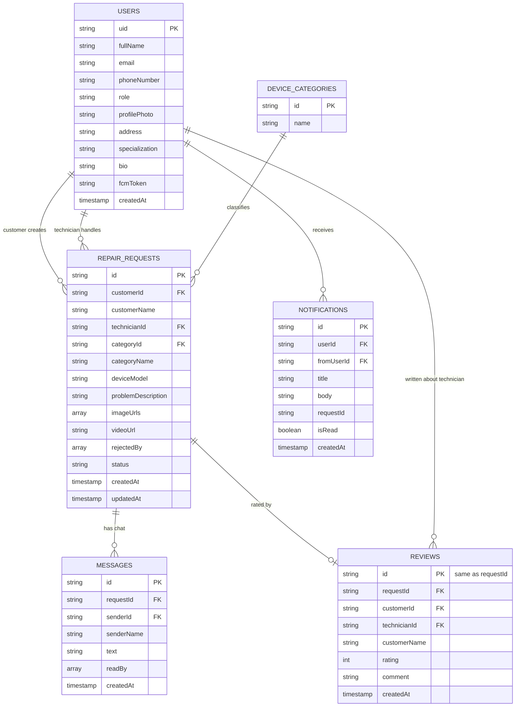

# TechFix: Database Design (Cloud Firestore)

Firestore is NoSQL: collections contain documents, and relationships are stored as document IDs (like foreign keys) because there are no JOINs.

## ERD

## Collections

### users

Purpose: every person who logs in. Document ID = Firebase Auth `uid`.
Read: signed-in users. Create: own document, role must be `customer`. Update: own profile (role unchangeable) or admin. Delete: none.

### device_categories

Purpose: device types shown in the request form (Phone, Laptop, ...). Managed by the admin.
CRUD: read (all signed-in), create/update/delete (admin only).

### repair_requests

Purpose: a customer's repair job. Relationships: `customerId` and `technicianId` point to `users`, `categoryId` to `device_categories`.
`customerName` and `categoryName` are duplicated on purpose, so lists need no extra reads.
`technicianId` is null until a technician accepts. `rejectedBy` hides a request from technicians who rejected it.
CRUD: customer creates (status `submitted`) and cancels; technician accepts, rejects and updates status of own jobs; admin updates; nobody deletes.

### messages

Purpose: chat between the customer and the assigned technician. `requestId` links to the repair. `readBy` holds UIDs who read it (read receipts). Time uses `serverTimestamp`.
CRUD: participants read and create; update only `readBy`; no delete.

### reviews

Purpose: rating of a technician. Document ID = `requestId`, so only one review per request. Allowed only when the request is `completed` or `delivered`. The average rating is computed from reviews, so it cannot be faked.
CRUD: create once, read; no update or delete.

### notifications

Purpose: in-app notifications. `userId` is the recipient. Recipient may only set `isRead`.
CRUD: create (any signed-in sender), read (recipient), update (`isRead`), no delete.

## Status storage

Statuses are lowercase strings: `submitted`, `assigned`, `in_review`, `in_progress`, `waiting_for_parts`, `completed`, `delivered`, `cancelled`. Strings are readable in the console and do not break if the order changes.
