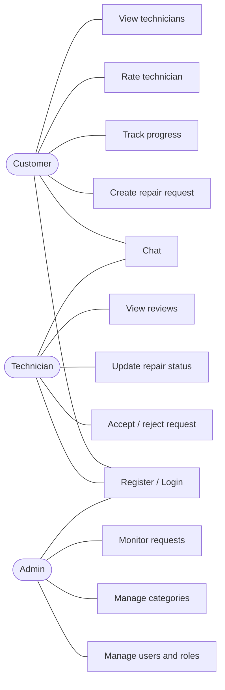

# TechFix: Use Cases

## Use case diagram

## UC-1 Register

- **Actor:** Customer. **Precondition:** none.
- **Main flow:** enter name, email, phone, password → system validates → creates Auth account and `users` document (role customer) → sends verification email.
- **Alternate:** email already used → error shown. Weak password → error shown.
- **Postcondition:** account exists, user must verify email.

## UC-2 Login

- **Actor:** all roles. **Main flow:** enter credentials (or Google) → system checks verification → reads role → opens the matching home.
- **Alternate:** wrong credentials → generic "incorrect email or password". Unverified email → verification screen.

## UC-3 Create repair request

- **Actor:** Customer. **Precondition:** logged in.
- **Main flow:** choose device type → enter model and problem → attach up to 3 photos and one video → submit → files upload, request saved as `submitted`, technicians notified.
- **Alternate:** upload fails → error message, nothing saved.

## UC-4 Accept or reject request

- **Actor:** Technician. **Precondition:** an open request exists.
- **Main flow (accept):** tap Accept → `technicianId` set, status `assigned` → customer notified.
- **Alternate (reject):** technician's UID added to `rejectedBy`; request disappears only for them.
- **Alternate:** another technician accepted first → error "someone else may have taken it".

## UC-5 Update repair status

- **Actor:** Technician. **Main flow:** open job → choose status → saved → customer notified (special message on Completed).

## UC-6 Chat

- **Actors:** Customer, Technician. **Precondition:** technician assigned.
- **Main flow:** open chat → send message → appears instantly for both → read receipt ticks when the other opens it → recipient notified.

## UC-7 Rate technician

- **Actor:** Customer. **Precondition:** request Completed or Delivered, no review yet.
- **Main flow:** choose 1 to 5 stars, optional comment → saved → technician's average updates.

## UC-8 Manage users and categories

- **Actor:** Admin. **Main flow:** open dashboard → change a user's role, or add, rename or delete categories → changes apply live.
